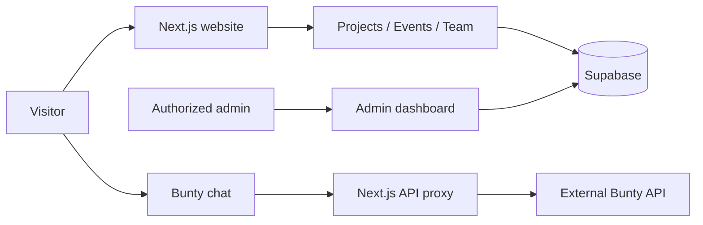

<p align="center">
  
</p>

<h1 align="center">e-Yantra MSIT</h1>

<p align="center"><strong>Think. Build. Innovate.</strong></p>
<p align="center">An interactive home for the robotics and engineering community at Maharaja Surajmal Institute of Technology.</p>

<p align="center">
  <a href="https://eyantra-website-wine.vercel.app/"><strong>Explore the website</strong></a>
  &nbsp;·&nbsp;
  <a href="https://eyantra-website-wine.vercel.app/bunty">Meet Bunty</a>
  &nbsp;·&nbsp;
  <a href="#explore-the-experience">The experience</a>
  &nbsp;·&nbsp;
  <a href="#how-it-works">Architecture</a>
  &nbsp;·&nbsp;
  <a href="#run-locally">Get started</a>
</p>

<p align="center">
  
  
  
  
  
</p>

---

## Why this website?

Engineering communities are built through projects, workshops, experiments, and the people behind them. The e-Yantra MSIT website brings those activities into one place: visitors can discover the society's technical domains, explore showcased work, find events, meet the team, and ask Bunty for guidance.

The experience is designed to feel like a small engineering lab rather than a static noticeboard. Interactive Three.js visuals, circuit-inspired components, responsive layouts, and a shared light/dark color system bring the society's identity into the interface. Behind the scenes, an authenticated content-management area lets authorized admins maintain the content.

## Explore the experience

<details open>
<summary><strong>Visitors · Discover the community</strong></summary>

The homepage introduces the community through an interactive engineering-lab scene and technical-domain sections. Dedicated pages surface projects, events, and team information without requiring visitors to navigate an admin system.

| Destination | What you can explore |
| --- | --- |
| [Home](https://eyantra-website-wine.vercel.app/) | Interactive lab, technical domains, featured projects, and community highlights |
| [Projects](https://eyantra-website-wine.vercel.app/projects) | Project showcase and category-based browsing |
| [Events](https://eyantra-website-wine.vercel.app/events) | Workshops, competitions, and past or upcoming activities |
| [Team](https://eyantra-website-wine.vercel.app/team) | The people behind the community |
| [Bunty](https://eyantra-website-wine.vercel.app/bunty) | Conversational help through the society's AI assistant |

The interface supports both light and dark themes, with a consistent navigation bar across public pages.

</details>

<details>
<summary><strong>Bunty · Ask, learn, and explore</strong></summary>

Bunty is a separate AI service integrated into the website through a server-side Next.js API route. Visitors send questions in the interactive chat interface; the website validates the request, forwards it to Bunty's external API, and renders the returned reply.

The page includes an animated character, a thinking state, chat history for the current page session, and responsive message controls. The current proxy sends individual prompts; it does not send the full conversation history to the external service.

**Integration boundary:** The website owns the UI and secure request proxy. The upstream Bunty service owns the model and generated responses.

</details>

<details>
<summary><strong>Admins · Maintain the website</strong></summary>

An authenticated administration area supports management of content for projects, events, and team members. The app uses Supabase for database records, authentication, and uploaded media, with database authorization and row-level security configuration maintained under `supabase/`.

The admin interface is accessed at `/admin/login`. Admin access requires the appropriate Supabase account and authorization configuration; it is not a public editing interface.

</details>

## How it works



The public-facing pages and admin tools share the same Next.js application. Data-oriented content is backed by Supabase; the AI chat follows a separate request path so the Bunty API credential stays on the server rather than being shipped to browsers.

<details>
<summary><strong>Inside a Bunty request</strong></summary>

1. The visitor submits a prompt through the Bunty chat component.
2. The frontend posts `{ "prompt": "..." }` to `/api/bunty/chat`.
3. The server route checks the request shape and length, applies a per-instance rate limit, and reads `BUNTY_API_KEY` from the server environment.
4. The route forwards the prompt to the external Bunty API and handles upstream errors and timeouts.
5. The frontend displays the returned reply or an error message.

The application-side rate limiter is in memory; it is not a globally coordinated distributed rate limit.

</details>

## Design and interaction

The visual system uses the homepage's warm ivory and graphite palette throughout the public pages, with the e-Yantra red accent and corresponding dark-mode colors. The site combines animated circuit motifs and a 3D lab with simpler content views so visitors can browse the content without the visuals getting in the way.

| Area | Implementation |
| --- | --- |
| Interactive lab | Three.js with React-driven scene integration |
| Design system | Tailwind CSS 4, shared CSS variables, light/dark themes |
| Motion | CSS animations and custom React interactions |
| Chat character | State-aware Bunty chat with the Yantra Buddy SVG mascot |
| Responsive UI | Shared navigation and adaptable page layouts |
| Campus map | Lazy-loaded Leaflet map with OpenStreetMap tiles and attribution in the shared footer |

### Yantra Buddy mascot

Yantra Buddy is the original, lightweight SVG mascot in the existing floating Bunty launcher. Its cream shell, charcoal visor, amber eyes, and red antenna follow the robot artwork used elsewhere on the site. The launcher stays fixed in the lower-right corner (110 × 132 px on desktop, 92 × 110 px on small screens); activating it opens the existing, separately labeled Bunty chat. Its contextual Home, Projects, Events, or Team tip is dismissible and auto-hides after seven seconds so it does not linger over page content.

To adjust the character, edit the inline SVG in [`components/bunty/YantraBuddy.tsx`](./components/bunty/YantraBuddy.tsx) and its colors, sizes, and motions in [`components/bunty/YantraBuddy.module.css`](./components/bunty/YantraBuddy.module.css). The global placement, tip copy, and state timing are in [`components/bunty/FloatingBunty.tsx`](./components/bunty/FloatingBunty.tsx) and [`components/bunty/FloatingBunty.module.css`](./components/bunty/FloatingBunty.module.css). The artwork uses the site's theme variables, so light and dark colors follow the existing theme.

| Trigger | Reaction |
| --- | --- |
| Page load | Wakes for 0.8 seconds, then idles with a 4.2-second float, 5.2-second breathing cycle, occasional head tilt, antenna motion, and randomized blinks |
| Pointer hover | Curious pose; returns to the current idle/listening state |
| Mascot activation | Plays a brief playful reaction, then listens while the Bunty chat is open |
| Bunty message submission | Thinking while the request is pending; switches to searching only if the real request remains pending after 0.85 seconds |
| Bunty reply | Celebrates, changes to happy, then returns to idle/listening |
| Bunty request error | Looks confused, then returns to idle/listening |
| 30 seconds without pointer, keyboard, touch, or scroll activity | Becomes drowsy, then sleeps after 3.5 seconds; activity wakes it |
| Page becomes hidden | Pauses CSS and blink animations until visible again |
| Reduced-motion preference | Displays a still mascot and disables marquee/chat animations; the skills list remains manually scrollable |

No `.avatar.json` export was present in the project. The official [Bible Strong Avatar Lab](https://github.com/smontlouis/bible-strong-avatar-lab) documents the React 19 renderer, and its [`@bible-strong/avatar-react` package](https://github.com/smontlouis/bible-strong-avatar-lab/tree/main/packages/avatar-react) is compatible with this app's React version. However, the renderer and its core dependency are `AGPL-3.0-only`; this repository has no declared project license. Because that license can impose source-availability obligations on a network-hosted derivative, the integration is deferred pending a licensing decision. Yantra Buddy is instead an original SVG/CSS character and uses no third-party avatar runtime or unsupported avatar schema.

The homepage also includes a continuously scrolling skills ticker after the hero. Its labels come from the site's existing technical-domain content; the repeated visual set is hidden from assistive technology, the animation pauses on hover, and reduced-motion users can scroll the single skills list manually. Edit the skill labels in [`components/home-v2/SkillsTicker.tsx`](./components/home-v2/SkillsTicker.tsx) and its presentation in [`components/home-v2/SkillsTicker.module.css`](./components/home-v2/SkillsTicker.module.css).

The homepage core-member cards use full-card photos, pause their marquee on hover or keyboard focus, and link to the full team. The single site footer combines the “Keep making things move” workshop scene with the previous footer’s navigation, contact, address, partnership, and copyright details. Internal route changes reset to the top of the destination page; the official contact email is `eyantramsit@gmail.com`.

### Featured masonry gallery

The Featured section keeps its server-fetched latest event/project updates and presents them in a responsive masonry layout. GSAP animates the cards into view and scales them on hover; keyboard focus also reveals the color treatment, and reduced-motion preference skips the entrance and hover scaling. To adjust the item layout, responsive breakpoints, animation defaults, or card appearance, edit [`components/home-v2/HomeFeaturedGallery.tsx`](./components/home-v2/HomeFeaturedGallery.tsx) and [`components/home-v2/HomeFeaturedGallery.module.css`](./components/home-v2/HomeFeaturedGallery.module.css). The update query and featured-card content stay in [`components/home-v2/HomeFeaturedSection.tsx`](./components/home-v2/HomeFeaturedSection.tsx).

## Technology and data

| Layer | Stack |
| --- | --- |
| Application | Next.js 16 App Router, React 19, TypeScript |
| Styling | Tailwind CSS 4, custom CSS tokens |
| 3D rendering | Three.js |
| Data, authentication, storage | Supabase (PostgreSQL, Auth, Storage) |
| AI integration | Server-side proxy to the external Bunty API |
| Hosting | Vercel |
| Quality checks | ESLint, TypeScript, Next.js production build |

## Run locally

### Requirements

Use a Node.js version compatible with the project's installed Next.js version. Node.js 22 LTS has been used successfully for local development.

```bash
# Clone the repository
git clone https://github.com/MukundGarg/eyantra-website.git
cd eyantra-website

# Install dependencies
npm install
```

Create `.env.local` in the repository root:

```dotenv
NEXT_PUBLIC_SUPABASE_URL=https://your-project.supabase.co
NEXT_PUBLIC_SUPABASE_ANON_KEY=your-supabase-publishable-or-anon-key
BUNTY_API_KEY=your-server-side-bunty-api-key
```

Do not commit `.env.local`. The Bunty API key must not have a `NEXT_PUBLIC_` prefix. API credentials used in earlier handoff materials should be rotated if exposed.

```bash
# Start the development server
npm run dev

# Check code quality
npm run lint
npx tsc --noEmit

# Create and run a production build
npm run build
npm run start
```

The local site is served at [http://localhost:3000](http://localhost:3000) by default.

### Supabase setup

The `supabase/` directory contains the schema, admin-authorization, row-level security, and seed SQL used by the project. Configure the database and storage policies for your own Supabase project before using the CMS.

Expected media bucket names referenced by the application are `team`, `projects`, and `events`. Admin access must be configured intentionally; never expose elevated Supabase service credentials in client code.

## Explore the codebase

<details>
<summary><strong>Repository map</strong></summary>

```text
app/
  page.tsx                 Homepage
  bunty/                   Bunty AI page
  events/                  Events page
  projects/                Projects page
  team/                    Team page
  admin/                   Authenticated content management
  api/bunty/chat/          Server-side external AI proxy
components/
  bunty/                   Chat panel, animated character, experience
  EngineeringLab3D.tsx    Interactive Three.js lab
  EngineeringLabHero.tsx  Lab hero section
  ...                      Shared navigation, sections, cards, UI
utils/
  supabase/                Supabase session and server/client helpers
  buntyApi.ts              Browser-side chat API wrapper
  storage.ts               Managed media storage helpers
data/                       Local fallback showcase data
supabase/                   SQL schema, auth policies, seed files
public/images/              Site logo and public image assets
proxy.ts                    Request/session middleware integration
```

</details>

## Scope and next steps

The current project includes the public website, an interactive 3D lab, projects/events/team views, the administrative CMS, light/dark theming, and the Bunty API integration.

Potential future improvements include stronger accessibility and device testing, richer project documentation, more complete society-specific knowledge for Bunty, conversational context support if its API evolves, and a clearer workflow for keeping events and team information current. These are opportunities, not claims of already-implemented functionality.

## Contributing

Contributions should preserve the site's existing design system and avoid exposing environment credentials. Work on a feature branch, explain user-facing changes, and run the lint, TypeScript, and build checks before proposing a merge.

---

<p align="center"><strong>Think. Build. Innovate.</strong></p>
<p align="center"><sub>Built for the e-Yantra MSIT engineering community.</sub></p>
